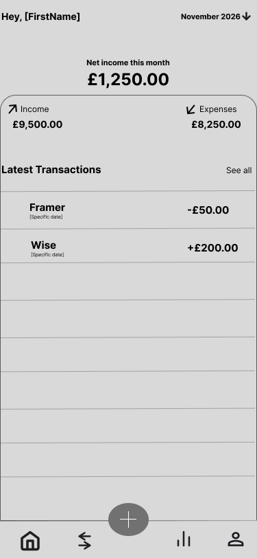
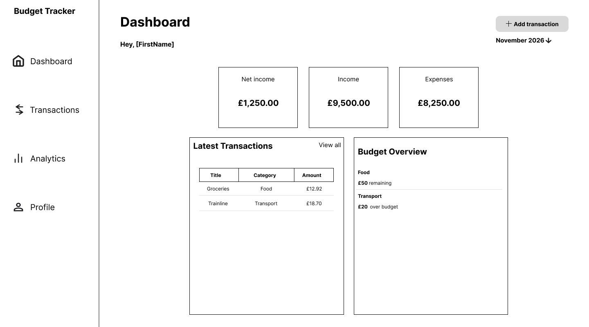
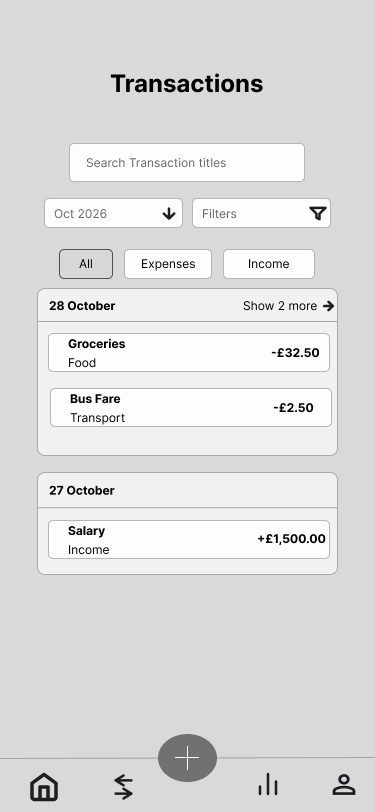
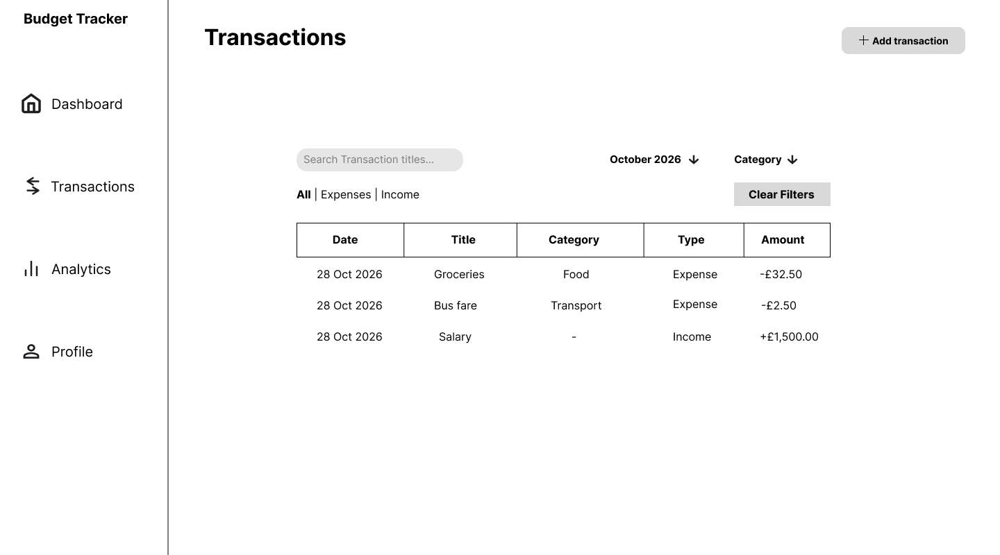
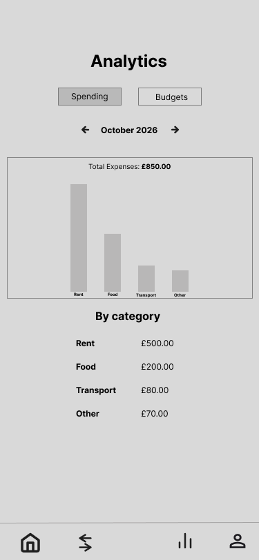
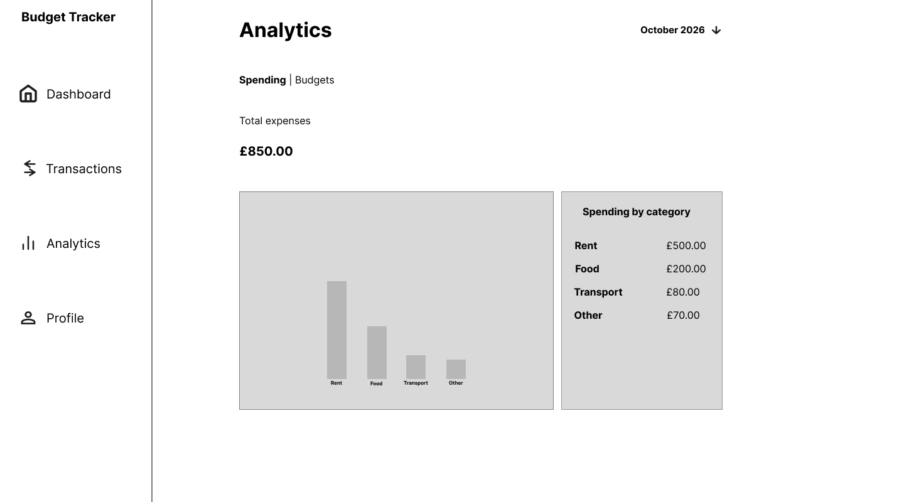
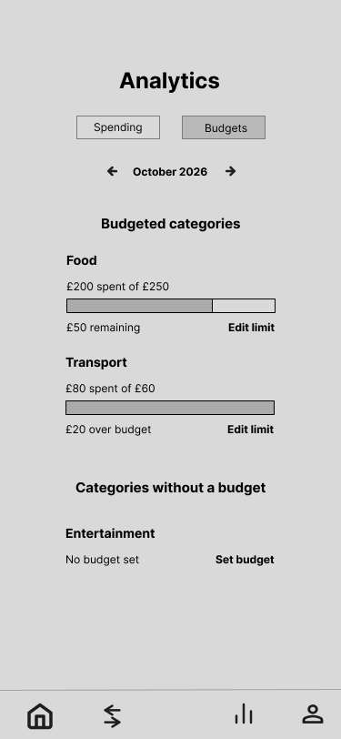
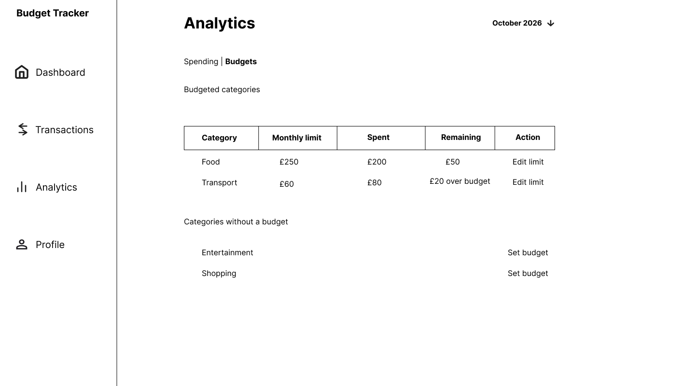

# Wireframes

## Overview

These low-fidelity wireframes describe the planned mobile and desktop
layouts for the Budget Tracker.

They define screen structure, navigation, and core interactions rather
than final colours, typography, or styling.

Mobile and desktop layouts support the same functionality. Desktop uses
the additional space to display information side by side rather than
introducing a separate set of features.

## File organisation

Wireframe images are stored in:

- `docs/wireframes/mobile/`
- `docs/wireframes/desktop/`

Image paths in this document are relative to `docs/wireframes.md`.

## Shared conventions

### Transaction fields

- Title: a short label identifying the transaction.
- Amount: the transaction value, entered as a positive number.
- Type: income or expense.
- Date: the date of the transaction.
- Category: required for expenses; not shown for income in the current design.

Transaction type determines whether an amount is displayed as income or
an expense. Users should not need to enter a negative amount for an expense.

### Reporting periods

- Dashboard summaries describe the displayed reporting month.
- Transaction history can be filtered by month.
- Spending analytics and budgets use a selected month and year.
- Financial figures for the same period must remain consistent across screens.

### Navigation

Mobile uses bottom navigation for:

- Dashboard
- Transactions
- Analytics
- Profile

The central plus button opens the Add Transaction form.

Desktop uses a left sidebar for the same destinations and a labelled
“Add transaction” button in the page header.

The current destination should be visually identifiable.

## 1. Dashboard

### Purpose

Provide an overview of the user's finances for the displayed month and
quick access to recent transactions.

### Mobile

### Desktop

### Content

- Greeting.
- Reporting month.
- Net income.
- Total income.
- Total expenses.
- Latest transactions.
- Link to the full transaction history.
- Access to Add Transaction.

### Behaviour

- Net income is calculated as total income minus total expenses for the
  displayed month.
- “See all” or “View all” opens transaction history.
- Selecting a transaction opens its details or editing flow.
- Adding, editing, or deleting a transaction updates the relevant summary
  figures and recent transaction list.

### Responsive behaviour

- Mobile presents the summary and latest transactions vertically.
- Desktop places the summary figures in a row above the transaction list.
- A compact budget overview may appear beside recent transactions on
  desktop if retained in the final design.

### States to support

- No transactions for the displayed month.
- Loading.
- Data could not be loaded.
- Populated dashboard.

## 2. Transaction history

### Purpose

Allow users to find, review, and access their recorded transactions.

### Mobile

### Desktop

### Content

- Search by transaction title.
- Month selector.
- Category filtering.
- All, Expenses, and Income filters.
- Transaction date, title, category where applicable, and amount.

### Behaviour

- Search and filters work together to narrow the displayed transactions.
- Users can clear filters to restore the broader transaction list.
- Selecting a transaction opens its details or editing flow.
- Income and expenses are distinguishable without relying only on colour.
- Transactions are displayed in a consistent date order.

### Responsive behaviour

- Mobile displays compact transaction entries grouped by date.
- Desktop displays transactions in a table with columns for date, title,
  category, type, and amount.
- Desktop amounts are right-aligned to make values easier to compare.
- Mobile filters may use a separate panel where space is limited.
- Desktop filters appear above the table.

### States to support

- No transactions recorded.
- No transactions in the selected month.
- No results matching the current search or filters.
- Loading.
- Data could not be loaded.

## 3. Analytics - Spending

### Purpose

Show how much the user spent during the selected month and how that spending
is distributed across expense categories.

### Mobile

### Desktop

### Content

- Spending and Budgets tabs.
- Selected month and year.
- Previous and next month controls.
- Total expenses for the selected month.
- Spending visualisation.
- Category spending breakdown.

### Behaviour

- Changing the month updates the total, visualisation, and category breakdown.
- The total expense figure equals the sum of the category spending amounts.
- Income is excluded from expense totals and category spending.
- Switching between Spending and Budgets preserves the selected month.

### Responsive behaviour

- Mobile stacks the visualisation and category breakdown.
- Desktop places them side by side where sufficient space is available.
- The layout returns to a single column when side-by-side content becomes
  difficult to read.

### States to support

- No expenses in the selected month.
- Loading.
- Data could not be loaded.
- Populated spending breakdown.

## 4. Analytics - Budgets

### Purpose

Allow users to compare category spending against monthly limits and manage
those limits.

### Mobile

### Desktop

### Content

- Spending and Budgets tabs.
- Selected month and year.
- Previous and next month controls.
- Budgeted categories.
- Categories without a budget.

For each budgeted category:

- Category name.
- Budget limit.
- Amount spent.
- Remaining amount or overspending amount.
- Progress indicator.
- “Edit limit” action.

For each category without a budget:

- Category name.
- Indication that no budget is set.
- “Set budget” action.

### Behaviour

- Changing the month updates the displayed limits and spending.
- “Set budget” opens the budget form with the category and month preselected.
- “Edit limit” opens the form with the existing limit populated.
- Saving a budget updates the relevant category entry.
- A category moves into the budgeted section after a budget is created.
- Overspending is communicated explicitly, such as “£20 over budget”.
- Spending remains visible even when it exceeds the limit.

### Responsive behaviour

- Mobile presents each category as a vertically arranged entry.
- Desktop aligns category names, limits, spending, and remaining amounts
  in comparison rows.
- Categories without a budget remain in a separate section below.

### Design decisions

- There is no separate page-level “Set category budget” button.
- Budget creation begi